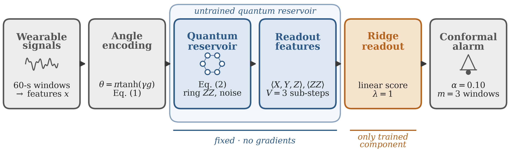
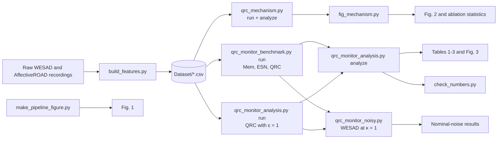

# Subject-Independent Autonomic Stress Monitoring via Quantum Reservoir Computing

[](https://doi.org/10.5281/zenodo.24234285)
[](LICENSE)


Code and results for:

> S. Papamentzelopoulos and S. Nikoletseas, **"Subject-Independent Autonomic Stress Monitoring via Quantum Reservoir Computing: Signal-Dependent Effects of Hardware Noise,"** EMBEC 2027.

This repository contains the complete pipeline behind the paper:

* feature extraction from raw wearable signals;
* an untrained quantum reservoir computer (QRC) with a ridge readout and split-conformal alarms;
* the classical baselines;
* the leave-one-subject-out (LOSO) full-stream benchmark on WESAD and AffectiveROAD;
* the recurrence × noise ablation;
* every statistic, table and figure reported in the paper.

All numbers are computed by the scripts below. None is hard-coded.

<p align="center">
  
</p>

*Monitoring pipeline (Fig. 1).* Angle-encoded windows drive a fixed, leaky density-matrix reservoir with ring ZZ coupling and a simulated noise channel. Observables read at V = 3 virtual sub-steps feed a ridge readout, which is the only trained component. A split-conformal layer then turns the readout's score into an alarm. Setting the leak to ε = 1 removes recurrence (QRC<sub>ε=1</sub>).

---

## Key results

- **Parity, not advantage.** On WESAD, QRC is statistically equivalent to a leak-matched classical echo state network (ESN): AUROC +1.2 pp, TOST p = 0.040. It sits 1.2 pp below a memoryless logistic baseline, with 3.9 pp lower AUPRC.
- **Noise acts only through recurrence.** Across ten random reservoirs, the memoryless reservoir is noise-invariant: its AUROC changes by at most 4 × 10⁻⁵ between κ = 0 and κ = 3. Noise pulls the recurrent reservoir toward it in 42 of 50 reservoir–cell pairs, helping where recurrence hurt and hurting where it did not.
- **Recurrence can be switched off.** With 92 %-overlapping windows, removing recurrence leaves AUROC unchanged (−0.2 pp, TOST p = 3.9 × 10⁻¹⁰). It also smooths the score stream (lag-1 autocorrelation +0.057).
- **Alarm burden.** All methods detect WESAD stress episodes well above a circular-shift null. At matched false-alarm rates, however, QRC raises 3.4–7.0 more false alarms per hour than the ESN.
- **Negative control.** On full streams, every method is at chance on AffectiveROAD (AUROC 0.471–0.529).

All circuits use at most six qubits and are simulated exactly. The study asks what a quantum reservoir does under honest evaluation, not whether it beats classical methods.

---

## Repository layout

```
.
├── build_features.py          raw WESAD / AffectiveROAD signals -> windowed feature CSVs
├── qrc_base.py                configuration, data loading, encoder, conformal layer, metrics, statistics
├── qrc_core.py                quantum reservoir (reduced readout), pinned reservoir settings, ridge readout
├── qrc_experiment.py          classical echo state network (ClassicalESN)
├── qrc_harness.py             full-readout quantum reservoir, model factory, stream loader
├── qrc_mechanism.py           recurrence x noise ablation                         (Stage 1)
├── fig_mechanism.py           Fig. 2 and ablation statistics                      (Stage 1)
├── qrc_monitor_benchmark.py   full-stream LOSO benchmark                          (Stage 2a)
├── qrc_monitor_analysis.py    QRC without recurrence + all benchmark analyses     (Stages 2b-2c)
├── qrc_monitor_noisy.py       WESAD rerun at nominal noise                        (Stage 3)
├── make_pipeline_figure.py    Fig. 1                                              (Stage 4)
├── check_numbers.py           prints the values quoted in the paper               (Stage 5)
├── requirements.txt           pinned dependencies
├── figures/                   figure files used in the manuscript
├── Output/V2/                 outputs of the runs reported in the paper
│   ├── mechanism/
│   ├── monitor/
│   └── monitor_noisy/
├── legacy/                    earlier, preliminary analyses (see "Legacy material")
├── LICENSE
└── README.md
```

`Dataset/` holds the feature CSVs. It is created locally by `build_features.py` and is not part of the repository.

---

## Installation

```bash
git clone https://github.com/papamentze/QuantumReservoirComputingStressMonitoring.git
cd QuantumReservoirComputingStressMonitoring
python -m venv .venv
source .venv/bin/activate            # Windows: .venv\Scripts\activate
pip install -r requirements.txt
```

Python 3.11 or newer is required by the pinned NumPy and SciPy releases. Key pins:

* PennyLane 0.45.1
* NumPy 2.4.6
* SciPy 1.17.1
* scikit-learn 1.9.0
* pandas 2.3.3
* NeuroKit2 0.2.13

Run every command from the repository root, because all data and output paths are relative to it.

---

## Data

Neither dataset is redistributed here. Obtain both from their providers under their terms of use.

| Dataset | Sensor | Modalities | Participants | LOSO unit |
|---|---|---|---|---|
| WESAD (Schmidt et al., ICMI 2018) | RespiBAN chest, 700 Hz | ECG → HRV, EDA, respiration | 15 subjects | `subject` |
| AffectiveROAD (El Haouij et al., SAC 2018) | Empatica E4 wrist | BVP → pulse-rate variability, EDA | 9 drivers with usable drives (13 of 14 drives) | `driver_id` |

Build the feature tables:

```bash
python build_features.py --selftest                                         # DSP sanity check, no data needed
python build_features.py --wesad-root "<WESAD root containing S*/S*.pkl>" --out Dataset
python build_features.py --road-root  "<AffectiveROAD folder containing Database/>" --wrist Left --out Dataset
```

This writes `Dataset/{wesad_hrv,wesad_eda,wesad_resp,road_hrv,road_eda}.csv`. Key properties of these tables:

- **Windowing.** Windows are 60 s long with a 5 s hop, cut within maximal single-condition runs. Consecutive windows therefore overlap by 55 s (92 %), and no window crosses a condition boundary.
- **No preprocessing at this stage.** Scaling and imputation are not applied here; both are fitted per fold, on training subjects only.
- **WESAD labels.** Baseline, amusement and stress are all kept, but amusement is excluded from every monitoring stream.
- **No AffectiveROAD respiration.** The public release has no respiration waveform, so there is no `road_resp.csv`.
- **AffectiveROAD stress labels.** The continuous 0–1 subjective stress metric is binarized at 0.60. This is our threshold, fixed a priori, and gives a mean stress prevalence of 0.70. The benchmark and ablation scripts hard-code it.
- **AffectiveROAD folds.** Folds are by `driver_id`, never `drive_id`. Some participants drove several times, so folding on drives would leak identity.
- **Signal-quality columns.** AffectiveROAD rows carry `motion` and `n_beats` columns for quality gating. The `--motion-drop` filter is optional and off by default.

Feature extraction uses NeuroKit2, which is installed with the requirements. Without it, the extractor falls back to built-in detectors, which will not reproduce the paper's features exactly.

---

## Reproducing the paper



How the run stages behave:

- **Resumable.** Each stage skips any configuration already on disk, so repeating the same command continues an interrupted run.
- **Parallel folds.** `--jobs` sets the number of parallel LOSO folds; set it to your core count. The run scripts limit BLAS to one thread per worker process.
- **Analyses without recomputation.** If the per-fold pickles are present under `Output/V2/`, the analysis steps (`analyze`, `fig_mechanism.py`, `check_numbers.py`) can be rerun without recomputing any reservoir.

### Stage 1: Recurrence × noise ablation (Sect. 4.2, Fig. 2)

```bash
python qrc_mechanism.py run     --out Output/V2/mechanism --draws 10 --jobs 8
python qrc_mechanism.py analyze --out Output/V2/mechanism
python fig_mechanism.py         --out Output/V2/mechanism
```

This stage crosses recurrence (ε ∈ {0.15, 1}) with noise scale κ ∈ {0, 0.5, 1, 2, 3} in all five cells, over ten independently drawn reservoirs. `fig_mechanism.py` then:

* prints the memoryless reservoir's largest AUROC change across κ (the invariance check);
* writes the per-cell and pooled statistics quoted in the paper;
* renders Fig. 2.

### Stage 2: Full-stream benchmark (Sects. 4.1, 4.3–4.5; Tables 1–3; Fig. 3)

```bash
# 2a  memoryless logistic baseline, ESN and QRC: 5 cells x 5 seeds
python qrc_monitor_benchmark.py run --out Output/V2/monitor --jobs 8

# 2b  QRC without recurrence (ε = 1): same splits, seeds and coupling draws
python qrc_monitor_analysis.py run --out Output/V2/monitor --methods qrc_nomem --jobs 8

# 2c  all benchmark tables, contrasts, alarm analyses and Fig. 3
python qrc_monitor_analysis.py analyze --out Output/V2/monitor
```

`qrc_monitor_benchmark.py analyze` writes earlier `V2_*` summaries that the paper does not use. The paper's results come from step 2c.

### Stage 3: WESAD at nominal noise (Sect. 4.2, second paragraph)

```bash
python qrc_monitor_noisy.py run --jobs 8
python qrc_monitor_noisy.py analyze
```

This reruns the recurrent and memoryless full-readout QRC on the three WESAD cells at κ = 1. It reuses the benchmark's folds, seeds, coupling draws, encoder, calibration and alarm logic; only the noise differs.

* Results are written to `Output/V2/monitor_noisy/`.
* The benchmark's noise-free `qrc` and `qrc_nomem` runs are read from `Output/V2/monitor/` (set with `--benchmark`).
* The gap and invariance summaries are printed to the console.

### Stage 4: Pipeline figure (Fig. 1)

```bash
python make_pipeline_figure.py
```

This needs no data. It writes `fig_pipeline.{png,pdf,tiff}` to both `figures/` and `Output/figures/`, and checks that every label fits inside its box.

### Stage 5: Check the reported numbers

```bash
python check_numbers.py
```

This reads `Output/V2/monitor/V3_*.csv` and prints the following, for direct comparison with the paper:

* the Table 2 contrasts;
* the per-cell lag-1 and smoothed-AUROC contrasts;
* false alarms per hour at matched FAR;
* null-adjusted detection.

---

## Where each result comes from

| Paper | Produced by | Output (under `Output/V2/` unless stated) |
|---|---|---|
| Fig. 1 | `make_pipeline_figure.py` | `figures/fig_pipeline.*` |
| Sect. 4.2 and Fig. 2: ablation, κ-invariance, 42/50 pairs | `qrc_mechanism.py run`, `fig_mechanism.py` | `mechanism/mech_gap_summary.csv`, `mechanism/mech_gap_by_draw.csv`, `mechanism/fig_noise_mechanism.*` |
| Sect. 4.2: memory-capacity floor | `qrc_mechanism.py analyze` | `mechanism/mech_mc.csv`, `mechanism/mech_summary.csv` |
| Sect. 4.2: nominal-noise rerun | `qrc_monitor_noisy.py` | `monitor_noisy/V4_discrimination.csv`, `monitor_noisy/V4_contrasts.csv`, console summary |
| Table 1 | `qrc_monitor_analysis.py analyze` | `monitor/V3_discrimination.csv` |
| Table 2 and Sect. 4.1 | `qrc_monitor_analysis.py analyze` | `monitor/V3_contrasts.csv` |
| Sect. 4.3: predictions P1–P2 | `qrc_monitor_analysis.py analyze` | `monitor/V3_predictions.csv` |
| Sect. 4.3 P3 and Sect. 4.4: matched false alarms per hour | `qrc_monitor_analysis.py analyze` | `monitor/V3_alarm_matched.csv` |
| Table 3 | `qrc_monitor_analysis.py analyze` | `monitor/V3_alarm_pinned.csv` |
| Sect. 4.4: null-adjusted detection | `qrc_monitor_analysis.py analyze` | `monitor/V3_alarm_null.csv` |
| Fig. 3 and Sect. 4.5 | `qrc_monitor_analysis.py analyze` | `monitor/fig_operating_curve_v3.*` |
| Sect. 4.5: preliminary truncated-stream result | earlier `qrc_harness.py` CLI | `legacy/` |

### Output layout written by the scripts

```
Output/V2/
├── mechanism/
│   ├── mech_auroc.csv             per-subject AUROC for every cell x draw x ε x κ
│   ├── mech_mc.csv                linear memory capacity for every cell x draw x ε x κ
│   ├── mech_summary.csv           per-cell noise effect and memory capacity
│   ├── mech_mediation.csv         noise effect with minus without recurrence
│   ├── mech_sign_agreement.csv    ΔAUROC vs Δmemory-capacity sign agreement
│   ├── mech_gap_by_draw.csv       recurrent minus memoryless AUROC per draw and κ
│   ├── mech_gap_summary.csv       statistics quoted in Sect. 4.2
│   ├── fig_noise_mechanism.*      Fig. 2
│   └── fig_noise_memory.*         diagnostic, not in the paper
├── monitor/
│   ├── <dataset>/<modality>/<method>_seed<seed>.pkl
│   ├── V3_discrimination.csv      Table 1
│   ├── V3_contrasts.csv           Table 2
│   ├── V3_predictions.csv         Sect. 4.3
│   ├── V3_alarm_pinned.csv        Table 3
│   ├── V3_alarm_matched.csv       Sects. 4.3-4.4
│   ├── V3_alarm_null.csv          Sect. 4.4
│   └── fig_operating_curve_v3.*   Fig. 3
└── monitor_noisy/
    ├── wesad/<modality>/{qrc_noisy,qrc_nomem_noisy}_seed<seed>.pkl
    ├── V4_discrimination.csv
    └── V4_contrasts.csv
```

**Pickle contents.** Each pickle holds one row per held-out subject: AUROC, AUPRC, EWMA-AUROC, and the conformal p-value and label sequences that all alarm analyses read.

**Method names:**

| Name | Model |
|---|---|
| `memoryless` | logistic regression |
| `esn` | classical echo state network |
| `qrc` | quantum reservoir, ε = 0.15 |
| `qrc_nomem` | quantum reservoir, ε = 1 |
| `qrc_noisy` | κ = 1 counterpart of `qrc` |
| `qrc_nomem_noisy` | κ = 1 counterpart of `qrc_nomem` |

---

## Method summary

### Encoding

Features are grouped into physiologically defined autonomic branches, one per qubit: Q = 5 for HRV, and Q = 6 for EDA and respiration. Per fold, `SuperNodeEncoder` imputes fit-subject medians, standardizes, averages within each branch and restandardizes. This gives

```math
\theta_q = \pi \tanh\big(\gamma\, g_q(x)\big), \qquad q = 1, \dots, Q, \qquad \gamma = 1 .
```

### Quantum reservoir

The reservoir is a leaky open-system recurrence on the Q-qubit density matrix:

```math
\rho_t = \mathcal{N}_\kappa\Big[\, U(\theta_t)\big((1-\varepsilon)\,\rho_{t-1} + \varepsilon\,\rho_0\big)\,U(\theta_t)^{\dagger} \Big]
```

**Unitary.** U(θ) applies R<sub>x</sub>(θ<sub>q</sub> + b<sub>q</sub>) and R<sub>z</sub>(θ<sub>q</sub>/2) on every qubit, where b<sub>q</sub> is a fixed random bias. It then applies a fixed random Ising ZZ ring with coupling scale 0.6. Nothing in U is trained.

**Leak.** With ε = 0.15, the state carries information from earlier windows. With ε = 1, the update becomes the memoryless map ρ<sub>t</sub> = 𝒩<sub>κ</sub>[U(θ<sub>t</sub>) ρ<sub>0</sub> U(θ<sub>t</sub>)<sup>†</sup>].

**Readouts.** Two readouts are used:

| Readout | Used in | Class | Observables |
|---|---|---|---|
| Full | benchmark | `RichQuantumReservoir` | ⟨X<sub>q</sub>⟩, ⟨Y<sub>q</sub>⟩, ⟨Z<sub>q</sub>⟩ per qubit and ⟨Z<sub>a</sub>Z<sub>b</sub>⟩ per coupled pair, read at V = 3 virtual sub-steps: (3Q + \|E\|)·V ∈ {60, 72} features |
| Reduced | ablation | `QuantumReservoir` | ⟨Z<sub>q</sub>⟩ and ⟨Z<sub>a</sub>Z<sub>b</sub>⟩ |

Reservoir features, plus a skip connection from the input angles, feed a ridge readout (λ = 1). This readout is the only trained component.

**Noise channel 𝒩<sub>κ</sub>.** On every qubit, it applies depolarizing (p₁ = 0.01κ), amplitude-damping (γ₁ = 0.05κ) and phase-damping (γ₂ = 0.02κ) channels. As a two-qubit proxy, it also applies single-qubit depolarizing (p₂ = 0.10κ) on both qubits of every coupled pair. κ = 1 is the nominal level. In the full-readout reservoir, each virtual sub-step additionally applies the one-qubit depolarizing and amplitude-damping channels.

**Simulation.** Simulation is exact, using PennyLane `default.mixed` with analytic expectations and no shot noise. The benchmark itself is noise-free (κ = 0).

### Baselines

- **Memoryless (Mem):** logistic regression on the same standardized angles.
- **Classical ESN:** 64 tanh units, spectral radius 0.9 and input scaling 0.5, with the same leak, skip connection and ridge readout as QRC.
- **QRC<sub>ε=1</sub>:** QRC with ε = 1, everything else unchanged.

All methods share folds, encoder, washout, calibration and alarm logic.

### Protocol, alarms and endpoints

- **LOSO.** In each fold, 35 % of the training subjects are held out, by subject, for calibration. The encoder and readout are fitted on the rest. The held-out subject is scored on its full chronological stream after a five-window washout.
- **Conformal layer.** Each score s<sub>t</sub> is compared with the scores 𝒞 of the calibration subjects' non-stress windows:

```math
p_t = \frac{1 + \lvert \lbrace c \in \mathcal{C} : c \ge s_t \rbrace \rvert}{\lvert \mathcal{C} \rvert + 1}, \qquad \pi_t = 1 - p_t .
```

- **Alarm rule.** An alarm is raised once p<sub>t</sub> ≤ α for m consecutive windows (α = 0.10, m = 3).
- **Endpoints:**
  - AUROC and AUPRC of π<sub>t</sub>;
  - EWMA-AUROC, with a half-life of five windows (the monitoring endpoint);
  - lag-1 autocorrelation of π<sub>t</sub>, as a measure of smoothness;
  - FAR, the fraction of non-stress windows in alarm;
  - false alarms per hour, the number of alarm onsets per hour of non-stress recording;
  - for stress episodes of at least three windows, the detection rate and the latency to first alarm.
- **Operating curves.** α is swept over 0.02–0.40. Matched comparisons take, per subject, the largest α whose FAR stays within 0.05, 0.10 or 0.15.
- **Circular-shift null.** Each p-value stream is rotated by 20 random offsets, each between a quarter and three quarters of its length. This keeps the stream's autocorrelation but breaks its alignment with the labels.
- **Seeds.** Five seeds (42, 3, 123, 37, 73) vary the fit/calibration split, the ESN draw and the quantum coupling draw. Metrics are averaged over seeds per subject.

### Ablation

The ablation runs ten reservoir draws × ε ∈ {0.15, 1} × κ ∈ {0, 0.5, 1, 2, 3} in all five cells, using the reduced readout.

Because only AUROC is measured, two simplifications apply. Each fold fits the ridge readout on all other subjects without a calibration split, and a label-free encoder is fitted once per cell. Neither choice differs between the two reservoirs being compared.

Linear memory capacity is also measured, as adjusted R² summed over delays 1–15. The probe drive is temporally shuffled and drawn from each modality's own angle distribution.

### Statistics

- **Unit of analysis.** Subjects are the unit. Pooled contrasts average each subject's per-cell differences over its modalities. This gives n = 24 pooled (15 WESAD subjects and 9 drivers) and n = 15 for WESAD alone.
- **Equivalence.** Two one-sided tests (TOST) at ±5 pp, with 90 % t-intervals. The nominal-noise rerun also tests at ±1 pp.
- **Differences.** Wilcoxon signed-rank tests, with Holm correction within pre-specified families.
- **Ablation pairing.** Ablation contrasts are paired by reservoir draw.

---

## Pinned settings

All values were fixed a priori and never tuned on a reported outcome.

| Component | Setting | Value |
|---|---|---|
| Windows | length / hop | 60 s / 5 s (92 % overlap) |
| Encoding | angle bandwidth γ | 1 |
| Reservoir | leak ε | 0.15 (QRC); 1 (QRC<sub>ε=1</sub>) |
| | coupling | Ising ZZ ring, scale 0.6 |
| | input scale / per-qubit bias | 1.0 / uniform(−0.5, 0.5) |
| | virtual sub-steps V | 3 (full readout) |
| | washout | 5 windows, all methods |
| | coupling and bias seed | 20260408 + benchmark seed; 20260408 + draw index in the ablation |
| Readout | ridge λ | 1.0 (bias unpenalized) |
| ESN | units / spectral radius / input scaling | 64 / 0.9 / 0.5 |
| Logistic baseline | regularization | C = 1 |
| Conformal | calibration fraction | 0.35 of training subjects |
| Alarm | α / m | 0.10 / 3 |
| Smoothing | EWMA half-life | 5 windows |
| Operating curves | α grid | 0.02–0.40, step 0.02 |
| | FAR budgets | 0.05, 0.10, 0.15 |
| | latency budgets (matched latency) | 15, 25, 50 s |
| Null | rotations per stream | 20, offsets in [L/4, 3L/4] |
| Benchmark | seeds | 42, 3, 123, 37, 73 |
| Ablation | draws / κ grid | 10 / 0, 0.5, 1, 2, 3 |
| Memory capacity | probe | 3 shuffled drives × 400 windows, delays 1–15 |
| Noise at κ = 1 | p₁ / p₂ / γ₁ / γ₂ | 0.01 / 0.10 / 0.05 / 0.02 |
| AffectiveROAD | stress threshold | 0.60 |

---

## Reproducibility and leakage safeguards

- **Leakage-free LOSO.** Folds are by subject (WESAD) or driver (AffectiveROAD). In the benchmark, imputation, scaling and branch statistics are fitted on fit subjects only. Calibration subjects are disjoint from both fit and test subjects.
- **Determinism.** All randomness comes from explicitly seeded NumPy generators, with one stream per seed and fold. Simulation is exact, with no shot noise. With the pinned environment, the pipeline reproduces every reported number exactly.
- **Chronology.** Streams keep file order, which is time order, and no window spans a condition change.
- **Equal treatment.** Every method uses identical folds, encoder, washout, calibration and alarm logic.

---

## Module reference

| File | Role |
|---|---|
| `build_features.py` | Raw signals → windowed HRV, EDA and respiration features. Includes `--selftest`. |
| `qrc_base.py` | `Config` (including the noise constants), `load_dataset`, autonomic branch routers, `SuperNodeEncoder`, coupling graphs, `conformal_pvalues`, ranking and calibration metrics, `bootstrap_ci`, `tost_paired`. |
| `qrc_core.py` | `QRCConfig` (pinned reservoir settings), `QuantumReservoir` (reduced readout, used in the ablation), `RidgeReadout`. `python qrc_core.py --smoke` runs one fold end-to-end. |
| `qrc_experiment.py` | `ClassicalESN`, the only part used by the paper. Its command-line experiments belong to an earlier noise study and are not reported. |
| `qrc_harness.py` | `load_stream`, `RichQuantumReservoir` (full readout), the logistic / ESN / QRC model factory and the EWMA smoother. Its command-line interface (default `--cap 30`) is the preliminary truncated-stream analysis. |
| `qrc_mechanism.py` | Recurrence × noise ablation and memory capacity (`run`, `analyze`). |
| `fig_mechanism.py` | Fig. 2, κ-invariance check, and the ablation statistics. |
| `qrc_monitor_benchmark.py` | Full-stream benchmark run for the logistic baseline, ESN and QRC. |
| `qrc_monitor_analysis.py` | QRC<sub>ε=1</sub> run; Tables 1–3, contrasts, matched and null alarm analyses, and Fig. 3. |
| `qrc_monitor_noisy.py` | WESAD rerun at κ = 1 for the recurrent and memoryless QRC. |
| `make_pipeline_figure.py` | Fig. 1 (schematic, no data). |
| `check_numbers.py` | Prints the values quoted in the paper. |

`qrc_base.py`, `qrc_harness.py` and `qrc_experiment.py` are imported by the stage scripts.

---

## Legacy material

`legacy/` keeps the outputs and scripts of earlier, preliminary analyses, for provenance:

- **`legacy/FINAL/`:** outputs of the earlier pipeline. This includes the preliminary truncated-stream benchmark: `qrc_harness.py` with its default `--cap 30`, which keeps the first 30 windows of each subject–state block. Sect. 4.5 quotes its AffectiveROAD-HRV result to show how truncation can manufacture apparent signal.
- **`legacy/QUANTUM/`:** a preliminary comparison with trained quantum models (VQC, QLSTM, QGRU). It is not reported in the paper.
- **`legacy/harness_consolidate.py`:** pools those outputs. Run it with the repository root on `PYTHONPATH`.
- **`legacy/README.md`:** documentation of the earlier pipeline. Scripts it mentions that are not in this repository are not needed to reproduce the paper.

Apart from the preliminary result cited in Sect. 4.5, no reported number comes from `legacy/`.

---

## Scope and limitations

- **Simulation only.** Results come from exact simulation with a phenomenological noise channel and no shot noise; there are no hardware runs. The noisy benchmark covers WESAD at nominal noise only, and the full noise sweep uses the reduced-readout reservoir.
- **Small cohorts.** The cohorts are 15 subjects and 9 drivers.
- **Type of stress.** The stress studied is protocol-induced acute stress in healthy adults, not clinically validated anxiety.
- **Specificity untested.** WESAD amusement is excluded, so specificity against non-stress arousal is not tested.
- **WESAD only.** AffectiveROAD stays at chance, so the subject-independent detection claim holds for the WESAD laboratory protocol only.
- **Empirical coverage.** Split-conformal guarantees assume exchangeability, which temporal dependence and cross-subject shift violate. Coverage is therefore empirical, not guaranteed.

---

## Citation

If you use this code, please cite the paper and the archived code release:

```bibtex
@inproceedings{Papamentzelopoulos2027QRC,
  author    = {Papamentzelopoulos, Spyridon and Nikoletseas, Sotirios},
  title     = {Subject-Independent Autonomic Stress Monitoring via Quantum Reservoir Computing:
               Signal-Dependent Effects of Hardware Noise},
  booktitle = {EMBEC 2027},
  year      = {2027},
  note      = {Full bibliographic details to be added on publication}
}

@software{Papamentzelopoulos2026QRCcode,
  author = {Papamentzelopoulos, Spyridon and Nikoletseas, Sotirios},
  title  = {Code for "Subject-Independent Autonomic Stress Monitoring via Quantum Reservoir Computing"},
  year   = {2026},
  doi    = {10.5281/zenodo.24234285},
  url    = {https://doi.org/10.5281/zenodo.24234285}
}
```

---

## License

The code is released under the MIT License (see [LICENSE](LICENSE)). WESAD and AffectiveROAD are not distributed here and remain under their own terms.

## Contact

Spyridon Papamentzelopoulos: papamentze@ceid.upatras.gr
Computer Engineering and Informatics Department, University of Patras, Greece 